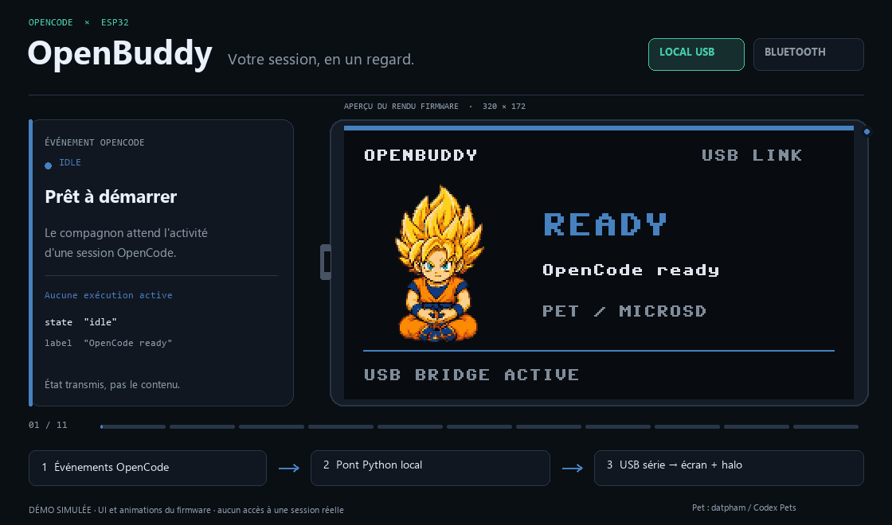

# OpenBuddy

**L'activité d'OpenCode, visible en un coup d'œil.** Un compagnon physique sur
**Waveshare ESP32-C6-LCD-1.47** : écran paysage 320×172, pet animé et halo RVB,
synchronisés en **Local USB** ou en **Bluetooth**.



*Scénario simulé, rendu par le vrai code d'affichage du firmware et les animations
RGB565 du pet installé. Ce n'est pas une capture d'une session OpenCode réelle.
[Aperçu fixe](docs/media/openbuddy-demo.png) · Pet « Super Saiyan Goku Combat » par
[datpham / Codex Pets](https://codex-pets.net/#/pets/super-saiyan-goku-combat).*

## Comment la synchronisation fonctionne

```text
OpenCode v2 → plugin d'événements → pont Python local → Local USB ou Bluetooth
                                                           ↓
                                                écran + animation + halo
```

Le plugin écoute les **événements OpenCode v2**, suit les sessions et les demandes
en attente, puis transmet un état au pont Python. Le pont envoie cet état au buddy ;
le firmware choisit l'écran, la couleur du halo et l'animation lue sur microSD.
Les images ne sont pas envoyées en continu par le transport.

| Dans OpenCode | Sur OpenBuddy |
|---|---|
| Prêt, aucune exécution active | `READY` — pet au repos |
| L'agent réfléchit | `THINKING` — halo bleu |
| Un outil s'exécute ou une réponse s'écrit | `WORKING` — pet en action, halo turquoise |
| Une autorisation attend une validation | `PERMISSION` — halo orange |
| Une question attend une réponse | `QUESTION` — halo jaune |
| L'exécution a réussi | `DONE` — animation de succès, halo vert |
| L'exécution a échoué | `ERROR` — animation d'échec, halo rouge |
| Une nouvelle tentative est programmée | `RETRY` — animation d'attente, halo ambre |
| Plus de heartbeat du pont pendant 15 s | `OFFLINE` — pet au repos, halo atténué |

Les permissions et questions sont prioritaires, y compris avec plusieurs sessions.
Sur Windows, **sons et notifications visuelles** complètent le compagnon pour les
permissions, questions, succès et erreurs. `--mute` coupe seulement les sons ;
`--no-notifications` coupe seulement les notifications Windows.

**Seuls des états et libellés génériques sont transmis** : pas de prompts, code,
texte de question ou résultats d'outils. Les boutons ne valident aucune autorisation
automatiquement : les réponses restent dans OpenCode.

## Deux modes, le même compagnon

| | Local USB | Bluetooth |
|---|---|---|
| Connexion | Câble USB-C **de données**, port série | Bluetooth LE : service GATT OpenBuddy + clavier HID |
| Démarrage du pont | `--serial auto` ou `--serial COMx` | Sans option de transport |
| Appairage | Aucun | BOOT long, vérification du code, puis **deuxième appui court** |
| Écran, pet et halo | Identiques | Identiques |
| Boutons et clavier | Pas de remontée des boutons ni de HID sur ce transport | Événements BOOT ; test F13 avec armement et appui physiques |

Le mode USB requiert le **firmware 0.3.0**. Le firmware conserve aussi le BLE :
le choix du transport se fait au lancement du pont. En USB, un seul outil peut
utiliser le port série à la fois. En Bluetooth, le buddy accepte un seul hôte à
la fois. Les autorisations USB/Bluetooth du système restent applicables.

## Installer depuis le dépôt

Prérequis : **Windows 10/11, CPython 3.11–3.14 x64, OpenCode v2** en service
local géré. Le plugin et le pont tournent sur la même machine qu'OpenCode.
Le plugin compilé est fourni : **Node/npm n'est pas nécessaire pour l'utiliser**.

Depuis PowerShell :

```powershell
git clone https://github.com/Nespouique/openbuddy.git
Set-Location openbuddy
python -m venv .venv
.\.venv\Scripts\python.exe -m pip install -r pc\requirements.txt
.\.venv\Scripts\python.exe -m pc.install_plugin
```

Dans OpenCode, utiliser `/reload` si nécessaire. Pour mettre à jour une installation
du plugin existante, ajouter `--replace` : les fichiers remplacés sont sauvegardés,
sans modifier les configurations OpenCode ni les autres plugins.
Pour une copie du dépôt déjà présente, utiliser `git pull` au lieu de la cloner.

### Local USB

Brancher le câble de données, puis lancer depuis la racine du dépôt :

```powershell
.\.venv\Scripts\python.exe -m pc.buddy --serial auto scan
.\.venv\Scripts\python.exe -m pc.buddy --serial auto status
.\.venv\Scripts\python.exe -m pc.opencode --serial auto
```

`auto` sélectionne l'unique port Espressif ; utiliser `--serial COMx` s'il y en a
plusieurs. **Garder le pont actif**. Les lanceurs `tools\openbuddy-usb.cmd` et
`tools\openbuddy-usb-stop.cmd` permettent aussi de le démarrer en arrière-plan et
de l'arrêter, sans démarrage automatique Windows.

Si le firmware doit être mis à jour, arrêter d'abord le pont et les autres outils
série, puis :

```powershell
.\.venv\Scripts\python.exe -m pip install -r pc\requirements-assets.txt
.\.venv\Scripts\python.exe -m pc.deploy --port COMx
```

Remplacer `COMx` par le port détecté. Le déploiement ne formate pas la carte et
conserve la SD et les clés Bluetooth. [Guide USB détaillé](distribution/workplace/README-usb.md).

### Bluetooth

Alimenter le buddy, ouvrir l'ajout d'appareil Bluetooth dans Windows, puis maintenir
BOOT environ 3 s. Comparer les codes, confirmer dans Windows et faire un
**deuxième appui court sur BOOT**. Déconnecter tout ancien hôte à portée.

```powershell
.\.venv\Scripts\python.exe -m pc.buddy scan
.\.venv\Scripts\python.exe -m pc.buddy status
.\.venv\Scripts\python.exe -m pc.opencode
```

Être reconnu comme clavier ne garantit pas l'accès au service GATT personnalisé.
[Guide Bluetooth détaillé](docs/ble-prototype.md).

### Diagnostic et arrêt

Dans un autre terminal, depuis la même racine :

```powershell
.\.venv\Scripts\python.exe -m pc.opencode status
.\.venv\Scripts\python.exe -m pc.opencode stop
```

`status` indique notamment `sources`, `usb_connected` / `ble_connected` et
`last_delivered`. `Ctrl+C` arrête aussi le pont lancé dans un terminal.
[Architecture et dépannage](docs/opencode-events.md).

## Pet et matériel

Le pet est lu sur la **microSD**, en RGB565, avec un seul buffer d'image en RAM.
Sans pack installé, un robot intégré prend le relais. Les sprites et les packs
du pet ne sont pas fournis dans le dépôt ou les kits : les visuels ci-dessus sont
une démonstration de l'affichage, pas un pack d'assets.

- [Préparer et installer une animation](docs/animations.md)
- [Matériel, brochage et précautions](docs/hardware.md)
- [Sources et attributions](THIRD_PARTY.md)

## Kits prêts à installer — optionnels

Pour installer sans cloner le dépôt, les [Releases](https://github.com/Nespouique/openbuddy/releases/latest)
proposent un **[kit Local USB](https://github.com/Nespouique/openbuddy/releases/latest/download/openbuddy-workplace-usb.zip)**
et un **[kit Bluetooth](https://github.com/Nespouique/openbuddy/releases/latest/download/openbuddy-workplace.zip)**,
avec les dépendances Windows x64 hors ligne et leur README. Les sources GitHub
ne contiennent pas le wheelhouse hors ligne.

Reconstruction locale des kits :

```powershell
python tools/package_workplace.py --variant usb --download-wheels
python tools/package_workplace.py --variant bluetooth --download-wheels
```

Un kit existant n'est remplacé qu'avec `--replace`.

## Fichiers

| Chemin | Rôle |
|---|---|
| `c6lcd/board_config.py` | Broches et géométrie, source unique |
| `c6lcd/main.py`, `companion.py` | Démarrage et boucle firmware |
| `c6lcd/buddy_ble.py` | HID, GATT, appairage et clés |
| `c6lcd/buddy_usb.py` | Protocole d'états sur le port série USB |
| `c6lcd/buddy_ui.py` | Écran 320×172 et halo |
| `c6lcd/buddy_protocol.py` | Protocole partagé PC / ESP32 |
| `c6lcd/shared_spi.py`, `sdcard_spi.py`, `storage.py` | Bus partagé et SD en lecture seule |
| `c6lcd/pet_player.py` | Lecteur RGB565, une image en RAM |
| `c6lcd/orientation_demo.py` | Ancienne démo conservée |
| `pc/buddy.py` | Diagnostic BLE et USB en Python |
| `pc/opencode.py` | Pont événements locaux → BLE/USB, authentifié et en lecture seule |
| `pc/notifications.py` | Sons système Windows non bloquants |
| `pc/toasts.py` | Notifications Windows natives, sans données privées |
| `pc/install_plugin.py` | Installation globale/par projet sans modifier la configuration |
| `integration/openbuddy/dist/` | Plugin v2 autonome, prêt à installer |
| `integration/openbuddy/src/` | Sources et tests du plugin |
| `pc/pet.py` | Conversion et installation des packs |
| `pc/deploy.py` | Déploiement des seuls fichiers firmware |
| `tools/openbuddy-usb.cmd`, `openbuddy-usb-stop.cmd` | Lancement en arrière-plan et arrêt du pont USB |
| `tools/build_readme_demo.py` | Génération hors ligne du GIF à partir du firmware et d'un pack local |
| `docs/hardware.md` | Matériel, brochage et précautions |

## Développement

Installer aussi `pc/requirements-assets.txt` pour Pillow et les outils de déploiement.
Les tests n'accèdent pas au matériel et n'exigent pas les images Goku :

```powershell
python -m unittest discover -s tests -v
npm --prefix integration/openbuddy test
npm --prefix integration/openbuddy run typecheck
```

Node/npm est utilisé uniquement pour développer/reconstruire le plugin :
`npm --prefix integration/openbuddy ci`, puis `npm --prefix integration/openbuddy run build`.
Ne pas modifier le bundle compilé à la main.

Pour régénérer le visuel du README depuis un pack déjà converti localement :

```powershell
python tools/build_readme_demo.py --pet-dir build/pets/super-saiyan-goku-combat
```

Le générateur utilise `BuddyUI`, `PetPlayer` et la police du firmware ; il ne se
connecte ni à OpenCode ni au buddy et ne télécharge aucun asset.
